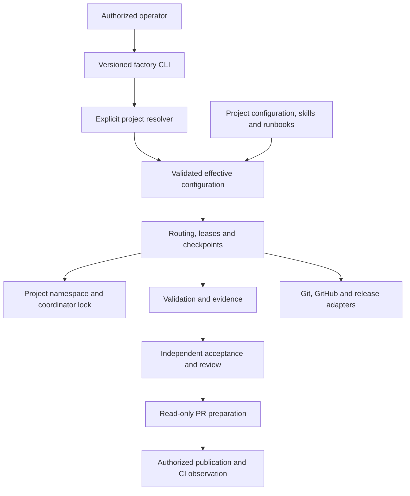

# Target architecture

Status: proposed implementation architecture.

## Factory ownership

CLI, orchestration, durable state/leases, evidence hashing and validation, Git/GitHub adapters, PR gates, shared role contracts and skills, schema/default policies, fixture tests and operator documentation belong here. Proposed layout: `src/cli/`, `src/core/`, `src/state/`, `src/evidence/`, `src/adapters/`, `schemas/`, `defaults/`, `skills/`, `tests/fixtures/` and `docs/`.

## Project ownership

`.factory/project.json` describes repository identity, base remote/branch, areas, specialists, executable checks, permitted adapters and local knowledge paths. Product glossary, ADRs, caption invariants, environment credentials, application CI and deployment/rollback runbooks stay in the project. A thin pinned launcher may exist; copied orchestration may not.

## Execution boundary

Resolve the canonical project root once, validate configuration and construct an explicit context passed to all modules. Imports must not load mutable project policy relative to the factory installation. Commands execute in the selected checkout with argument arrays and explicit environments; configured commands are trusted project code, not safe merely because they are schema-valid.

## State boundary

Derive a namespace from configured project identity plus normalized repository identity. Reject repository mismatches. Store durable records outside the factory installation, with explicit project-state selection. Use an atomic exclusive coordinator lock with owner/session, lease expiry and generation fencing; stale writers cannot commit after recovery. Worktrees share the project namespace and record distinct workspace identities. User-selected state paths must retain namespace and lock checks.

## Evidence boundary

Record factory ref and resolved SHA, schema/state versions, project identity and root, project candidate/base SHA, policy digest, environment identity without secrets, actor/session, check commands, timestamps/results, artifact hashes and validation report identity. Reject dirty candidates or capture a distinct content identity that cannot be presented as committed evidence. Adapter responses are evidence, never authorization.
