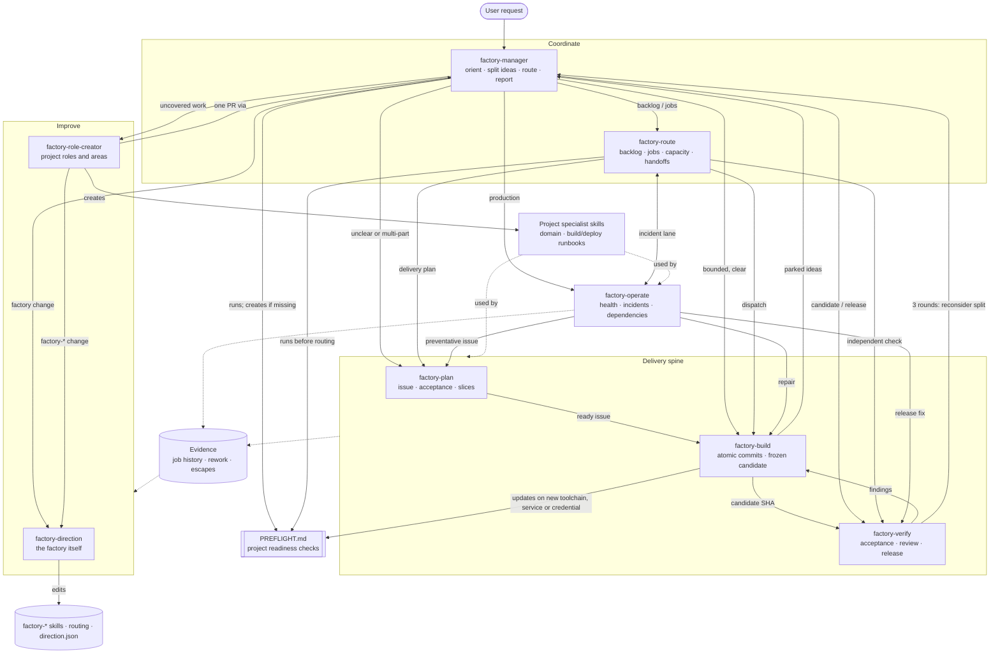

# Skill graph

The factory as skills only: the `factory-*` skills in `skills/`, project specialist
skills, and `docs/without-engine.md` in place of the engine's commands.

## The set

| Layer | Skill | Owns |
| --- | --- | --- |
| Entry | `factory-manager` | Orient (preflight), split ideas, route, choose checkout, report |
| Coordination | `factory-route` | Backlog, job claims/leases, capacity, handoffs, incident lane |
| Delivery | `factory-plan` | Issues, reproduction, acceptance scenarios, slicing |
| Delivery | `factory-build` | Atomic commits, regressions, frozen candidate |
| Delivery | `factory-verify` | Acceptance, review, release, production check |
| Run | `factory-operate` | Health, incidents, reliability, dependencies |
| Meta | `factory-direction` | Changes to the factory (skills, routing, priorities) |
| Meta | `factory-role-creator` | Project areas, roles, specialist skills |
| Project | specialists (e.g. `event-production-ui`, `oolive-build-deploy`) | Domain + build/deploy runbooks |
| Helpers | `skill-creator`, `writing-for-agents` | Writing skills |
| Project | `PREFLIGHT.md` at the project root | Readiness checks; created by the manager when missing, updated as the project changes |
| Substrate | `docs/without-engine.md` | Manual equivalent of each engine command |

## Graph

Reading it: one entry point (manager); a delivery spine plan → build ⇄ verify;
operate feeds back into that spine; direction and role-creator sit outside it and
improve it from the evidence it produces (dotted lines). Direction and role-creator
write skills with `skill-creator` and `writing-for-agents`; every skill uses
`docs/without-engine.md` where it names an engine command.

## Gaps the graph exposes

- `factory-route` relies on `factory-manager` step 1 for how to run the preflight.
- Skills still name engine commands and `docs/factory.md`, which exist only in a
  product checkout; skills-only use relies on `without-engine.md` mapping them.
- `factory-operate` still names caption-delivery signals and Azure (OOlive specifics).
